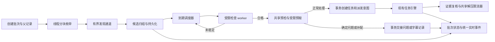

# 输入扫描队列与批次记录改造方案

日期：2026-10-25。状态：本地实现与专项验证已完成，未部署；性能验证边界见验收记录。

本方案基于当前本地代码及本次排查结果，保留设计约束与原始问题证据。持久扫描队列、共享预检、恢复交接、配置联动和记录协议已在本地实现；实际验证范围见 [验收记录](input-scan-queue-acceptance-20261025.md)。本文不包含生产发布授权。

## 1. 结论与范围

采用“流式发现 + 有界稳定检查 + 共享业务预检 + 提前分流/元数据预取 + 持久化交接 + 现有任务引擎”。

- 扫描负责发现、归组、源文件稳定检查；共享预检负责提前判断问题/字幕补配，正常候选交接现有引擎，不执行第二套解压调度。
- 一个分卷组只创建一个逻辑候选、一个根任务；各卷是成员，不分别排解压任务。
- 文件稳定等待用到期调度，检查一次后释放 worker，不能让 worker 睡 8 秒或 300 秒。
- 首个合格候选立即提交，不等全目录树扫描结束。
- PostgreSQL 保存批次、候选、提交意图和审计事实；Redis 保存高频快照与事件。
- 批次开始先建立父记录；发现阶段关闭、扫描候选处理结束、业务处理结束分别表达。
- 扫描并发独立于实际解压并发，保留共享解压限流器和 `extract_timing.version=1`。
- 设置页现有业务并发、解压并发、业务步骤和资源预算是执行依据；预检、预取不能绕过这些限制。配置接入和完整分流规则见第 14 节。

本轮改造覆盖手动扫描、watcher 入队协调、任务中心入口、操作历史聚合、观测与通知。保留现有问题作品处置及后台源文件归档执行器，补齐关联和展示，不把“已跳过”解释为“文件已搬走”。

## 2. 已确认的问题与设计对应

| 事实 | 当前影响 | 对应改动 |
| --- | --- | --- |
| 线上本次两组伴随卷检查分别约 16 秒、80 秒，总计约 96 秒 | 同组逐卷等待叠加，超过前端 60 秒请求超时 | 同组一次采样所有卷；定时复查；启动接口立即返回 |
| 本地 10 个伴随卷并行检查约 8.03 秒 | 已消除同组串行等待，但没有消除不同组串行等待 | 多组共享稳定观察窗口 |
| `process_directory` 仍先收齐候选，再顺序处理 | 首个任务依赖整棵目录树探测及前序慢组 | 发现与处理重叠 |
| `process_file` 部分异常返回 `None`，还会标记已处理 | 跳过、失败混淆，可能使后续扫描忽略失败源 | 返回结构化结果，仅成功交接或确定跳过更新对应状态 |
| `_scan_and_create_tasks` 在扫描结束后才写 `batch_start` | 子任务可能先完成，批次耗时起点错误 | 先写父，再允许提交 |
| 历史聚合没有“扫描还在产生子任务”栅栏 | 流式处理后可能提前宣布整批成功 | 新批次以 `producer_closed` 和候选结算状态为依据 |
| 当前后台扫描历史只在进程内 | 重启丢状态，刷新后难以接回 | 持久化批次及候选，支持重连与恢复 |
| `TaskEngine.submit` 先写内存再入队；快照写入异常会被记录后吞掉 | 不能以 submit 返回证明已持久化 | 新增事务提交入口与幂等派发 |
| 现有日志 writer 是 best effort | 不能直接承诺审计事件可靠送达 | 业务事务 outbox + writer 幂等写入 |
| 跳过 RJ01406188 后源文件归档被前台任务让路 | 跳过成功期间仍可能看见输入文件 | 展示后台归档关联、等待原因和实际结束时间 |

线上该例在 **2026-10-25 12:18:30.445** 已完成三卷归档及 SHA-256 核对，原输入目录已不存在；这不是本方案的部署结果。线上逐卷数据与本地并行数据环境不同，不能作为严格加速倍数。

## 3. 100 个包的耗时模型

先明确输入口径：“100 个物理文件、其中一些属于分卷”不等于“100 个逻辑包、其中 30 个是分卷组”。

当前近似：

```text
首次入队 = 全目录候选收集 + 前置状态查询 + 前序候选处理 + 当前候选检查
扫描总耗时 ≈ 目录发现耗时 + 各组检查耗时之和 + 提交耗时
```

如果是 100 个逻辑包，其中 30 个分卷组，每组约 8 秒，顺序稳定检查部分约 240 秒；持续变化的组还可能等到现有 300 秒上限。此处是模型推算，不是线上实测。

改造后：

```text
首次入队 = 批次及父记录持久化 + 找到首个合格候选
         + 该候选必要的归组/稳定检查与前置决策 + 提交事务
首次开始处理 = 首次入队 + 任务引擎排队
首次开始解压 = 开始处理 + 尚未完成的必要预检/证据复核 + 解压资源等待
```

30 个分卷组可以重叠观察，不再强制等待约 30 × 8 秒；真实下限仍受目录读取、文件变化、采样排队、数据库及磁盘竞争限制。不能承诺整批固定 8 秒。

普通单包无需等待其他分卷。分卷成员完整性需要同目录枚举完成或可信目录索引，因而首个分卷仍可能依赖所在目录的完整枚举，但不依赖其余目录树。未知文件魔数和带前缀 ZIP 探测仍是真实 I/O 成本；队列不能消除它。

目录闭合只能证明本轮见过哪些成员，不能证明最后一卷没有缺失。扫描检查已知主卷及编号缺口；无可靠总卷数的格式保留 `completeness=unknown`，最终由实际压缩包读取验证，不能仅凭编号连续宣称完整。

## 4. 执行结构与背压



### 4.1 发现

1. 使用 `os.scandir` 在线程中分块枚举，复用 `DirEntry.stat`；不先构造整棵树列表，不做全目录排序。
2. 已知后缀先便宜识别，未知文件按现有魔数及 embedded ZIP 规则检查；不能为性能删除伪装包识别。
3. 以目录为单位复用成员索引，分卷解析只对索引查找，避免每个候选重复 `listdir`。
4. 目录结束发出 `directory_closed`；全树结束发出 `producer_closed`。读取失败的目录单独记录，不能把异常当空目录。
5. 单包可先处理；分卷在目录闭合后核对成员，晚到卷使该组观察证据失效并重新采样。外部持续新增文件不能形成原子快照，提交前仍须复核。
6. 大目录索引超过内存预算时将成员索引分块落 PostgreSQL 临时业务记录，不因全目录列表占满内存；按批次清理。

线程与事件循环之间使用有界桥：线程通过 `run_coroutine_threadsafe` 投递，等待时短周期检查停止标记；禁止在线程直接访问 `asyncio.Queue`。取消先停止生产、取消未完成 put、排空或作废待处理项，再等待线程退出。不能只取消 `to_thread` 外层协程便宣布线程已结束。

### 4.2 检查和稳定观察

检查参数优先读取现有配置；只新增扫描内部积压和节流参数，不另设一套业务执行并发。下表新增值是待验证默认值：

| 参数 | 初始值 | 含义 |
| --- | --- | --- |
| 轻量检查协程上限 | `processing.max_workers` | 派生值，仅编排短采样；重预检另受共享业务许可约束 |
| `input_scan.discovery_queue_capacity` | 128 | 发现消息数上限，每条至多 32 个目录项，控制消息也计一条 |
| `input_scan.active_candidate_limit` | 256 | 内存中完整候选对象上限 |
| 正常待交接任务水位 | `2 × processing.max_workers` | 自动派生软水位，ready 超量留持久账本；不代表允许这些任务同时运行 |
| 稳定复查间隔 | `processing.file_stable_interval` | 复用现有配置，默认 2 秒 |
| 连续稳定次数 | `processing.file_stable_checks` | 复用现有配置，默认 3 次相邻样本一致 |
| `input_scan.stable_timeout_seconds` | 300 | 新增明确的扫描候选截止时间；不擅自复用用途不明的 `processing.max_wait_time` |
| `input_scan.progress_interval_seconds` | 1 | 非终态快照推送间隔 |

稳定证据包括大小、`mtime_ns`、文件身份和可读性；主文件及全部伴随卷一起检查，不能只等伴随卷。从现有解压稳定检查提取共享采样工具，不能把旧 `FileProcessor.wait_file_stable` 的 size-only 判定当作已满足。

上述稳定次数用于需要等待稳定的候选，分卷必须覆盖主卷及全部成员。当前 `FileProcessor` 写死 3 次/2 秒且成功后多睡一次，约 8 秒；新实现读配置，首样本不计稳定，默认约 6 秒后第三次一致即返回，另加实际 I/O 和调度时间。手动扫描普通单包保留当前 `wait_stable=false` 入口语义，做身份/可读性与提交前变化复核，不追加固定等待；真正执行前仍经过解压链路已有检查。watcher 原本要求等待稳定的单包继续观察。文件变化时两种入口都不能沿用过期证据。

一次检查返回 `ready / wait_until / skip / error`。`wait_until` 进入最小堆，worker 立即处理其他候选。到期组采用轮转和有限采样配额，避免大量组同一时刻到期挤死新单包；大组分块采样，全组证据合格后才提交。

等待候选超过内存上限时，状态存 PostgreSQL，内存只保留有限到期项；调度按 `(next_check_at, id)` 索引分页加载。不能把“有界队列”做成无限增长的等待堆，也不能因前 256 个组都在等下载就停止发现后面的单包。

目录发现落库使用批量事务；稳定采样只在内存/Redis 更新，状态改变或低频检查点才落库，禁止每次 stat 提交事务。数据库写入跟不上时背压生产者。

达到正常待交接水位后，已合格候选以 ready 状态留在持久账本，等引擎消费后再交接，不能把扫描队列的背压直接转移成无限引擎 pending 队列。此时等待原因是 engine_backpressure，不能算稳定等待。配置调小不回收已提交任务，只暂停新的正常交接；问题/字幕交接单独按数据库及业务许可背压，不被正常 pending 水位卡住。扫描内存受上述配额约束；既有引擎保留任务对象和历史的内存另外计量，本方案不声称整个应用 RSS 与任务数无关。

### 4.3 资源预算

- 检查 worker 数控制编排，不表示同时允许 4 个磁盘读取或 4 个解压进程。
- 目录枚举和探测短持有 `disk_io_local`；等待稳定不占磁盘槽、不持数据库连接。
- 新扫描统一通过 async 资源入口取得许可，再把操作交给线程；现有 async/sync semaphore 独立计数，不能混用后声称共享限额。
- 7z 清单/探测仍走 `archive_inspect`，实际解压仍走已有共享可调整 limiter，不恢复 `archive_cpu` 二次限流。
- 扫描不无差别启动全量清单/密码探测。确有合集/字幕判断需要的读取通过共享预检执行并复用结果，避免与引擎重复探测；正文第 14 节规定预算和优先级。
- 与前台解压竞争时降低扫描 I/O 发起速率，在块边界让路；记录让路时间，不通过提高解压并发掩盖扫描等待。
- 日志写入仍服从 `database_write`，不把运行态每秒写入 PostgreSQL。

## 5. 候选身份、排他与提交

### 5.1 身份

`candidate_id` 是稳定 UUID。`group_key` 由存储根身份、按实际文件系统规则规范化的父目录、压缩格式及分卷基名构成；单包使用完整源路径。不能用 RJ、basename 或当前成员清单 hash 作为唯一身份。

成员增加不改变候选 ID；保存原始路径、当前路径及规范化别名。Windows 路径大小写处理不能照搬到 Linux。指纹证明本轮观察对象未变化，不计算整包 SHA-256 来做扫描去重。

同批次 `(scan_id, group_key)` 唯一。重名但不同目录是不同候选；同一路径文件被替换后是新一代源对象，不能被永久 processed 标记遮蔽。

### 5.2 与 watcher、问题作品、延迟归档协调

- 保留当前单进程任务引擎部署模型，只允许一个扫描协调者；不新增分布式执行系统。
- 手动扫描与 watcher 共用候选提交入口和源占用登记，不能各自 check 后 submit。
- 复用 deferred archive 的源占用语义，统一加入同一排他协议；不能新建独立锁后让两套 claim 互不相见。
- 获取组与成员路径占用按稳定排序，防互锁；短数据库事务登记持久占用，不跨 8/300 秒持有事务或行锁。
- 未解决问题源快照可用于预过滤；规范化前、提交事务中仍核对最新问题状态和归档占用。
- 发现 `.aria2`、卷缺失、成员变更时推迟，不在不完整组上重命名或提交。
- 被其他活动任务占用：记录 `already_active` 和原任务 ID，不重新归属旧任务到新批次。
- 被归档占用：记录 `deferred_archive_claim` 和归档作业 ID，不把源重新加入解压队列。
- 已处理缓存仅作加速，最终占用/候选/任务唯一关系是事实依据。

源占用不能仅因租约超时便允许另一执行者重命名：文件系统操作无法用数据库 epoch 原子 fencing。首版禁止活进程间接管；协调者失锁立即停止新副作用，确认旧进程退出并核对路径后才恢复。支持多实例主动接管需另行设计，不能隐含承诺。

### 5.3 规范化与可靠提交

重命名先记录 `normalization_prepared` 及旧/新路径和指纹，再执行现有安全重命名，核对后提交映射；目标存在拒绝覆盖。中断恢复分别核对旧、新路径和身份，无法证明归属时标记待人工确认，不盲目再重命名。

新增 `commit_input_candidate` 事务入口，同一事务：

1. 锁定候选并核对批次取消状态、候选版本及最新源占用。
2. 确定唯一 `task_id`，写入现有 `tasks` 表的 pending 初始快照。
3. 绑定候选与任务、移交源占用，候选进入 `submitted`。
4. 写入 `task_dispatch` outbox，更新批次计数和 revision。

提交成功后才记“已提交”；不依赖当前 `persist_task_snapshot` 的吞异常行为。规范化是事务外文件系统步骤，靠准备记录恢复，不能宣称数据库事务覆盖文件重命名。

派发器使用原 `task_id` 重建任务；引擎新增 `enqueue_once(task_id)`，检查在途/已排队/终态后操作。启动恢复和 outbox 派发必须共用此入口，不得两边各入队一次。已执行任务的重复派发只确认交付，不触发重新解压。

同一任务的快照写入也要带版本条件；旧 pending 对象或旧 epoch 回调不能覆盖已经 processing/completed 的持久状态。派发幂等不能只靠 `self.tasks` 是否有键判断。

写库成功、入队前崩溃：重放派发意图。入队后、确认前崩溃：检查持久任务状态后幂等处理。队列交付是至少一次，任务身份和执行入口保证去重，不声称整个文件系统流程天然 exactly once。

提前分流使用同一提交协议的 destination 分支：在一个数据库事务中保存根任务快照、问题/字幕待办、候选 `routed` 状态、源占用移交、批次计数和生命周期 outbox；不写正常解压派发意图。现有问题/补配方法自行开 Session/commit，实施时须抽出可接受调用方事务的写入方法，不能直接串调旧方法冒充原子交接。预检需要临时字幕 stage 时先保存准备记录，事务只接管已核对的 stage；提交失败/取消/恢复按记录核对清理，不能留下无主目录。

## 6. 状态与计数协议

### 6.1 三个不同的结束点

| 字段 | 含义 |
| --- | --- |
| `producer_closed` | 本轮不再新增发现项，附 `close_reason=exhausted/cancelled/error` |
| `scan_status` | `starting / running / cancelling / completed / cancelled / failed / interrupted`；所有已发现候选处理完才 completed |
| `execution_status` | `not_started / running / waiting / success / partial / failed / cancelled / empty`，根据实际业务结果独立计算 |

扫描过程中已有任务全部结束，但 `producer_closed=false`，批次仍显示“扫描中”。发现关闭后仍有稳定等待候选，显示“等待源文件稳定”。全部候选分类完成后才关闭扫描；此时解压可能还在运行。

`waiting_manual`、`waiting_retry`、paused 都不能当成功；问题作品、字幕接管和部分入库沿用已有业务语义。多 RJ 拆出的子任务归属原根候选，根任务结论要包含其派生任务，不能用子任务条数抬高“提交包数”。

完成判定：

```text
scan_closed = producer_closed && 非终态扫描候选数 == 0
batch_settled = scan_closed && 所有已提交/已分流根任务及其派生链具有可结算业务结果
```

待人工/待重试显示 waiting，不发送“全部成功”。用户后续重试沿用既有尝试关系，重新计算当前展示状态；原结算事件作为历史事实保留，以新的结算版本记录变化，不能覆盖旧失败证据。

### 6.2 候选状态

```text
discovered -> checking -> waiting_stable -> checking
checking -> preflight -> ready -> normalizing -> submitted
preflight -> routed（destination=problem/subtitle）
任一未交接状态 -> skipped / failed / cancelled
中断后的非终态 -> reconciling -> checking 或 failed
```

等待原因单独字段：`directory_open / incomplete_volumes / file_changing / aria2_present / resource_wait / engine_backpressure / preflight_capacity / linkage_retry`。等待中的 preflight 计入 waiting 桶并保留 resume_stage；不能同时计在 preflight 和 waiting。`failed` 保存错误码和简要原因；不能用 `None` 同时表示失败和跳过。稳定超时记 `failed:source_not_stable`，保留以后新扫描重新评估的机会，不写永久 processed。

### 6.3 计数

运行中总量未知，`total_candidates=null`；展示“已发现 N 组”，不能把已发现数当最终分母。

```text
discovered_groups =
  pending + checking + waiting + preflight + ready + normalizing
  + submitted + routed + skipped + failed + cancelled
routed = routed_problem + routed_subtitle
skipped = sum(互斥 skip_reason 的数量)
```

`pending` 包含持久化积压项；每个候选任一时刻只在一个桶中。`submitted/routed` 是候选扫描终态，但对应业务仍可能 pending、processing、待人工或失败。转入问题不计 skipped；字幕待办接管不计入库成功。

物理与业务量分别保存：

- `enumerated_files`：实际枚举的普通文件数，含非压缩文件。
- `archive_member_files`：识别为候选组成员的去重文件数，含分卷。
- `discovered_groups`：去重逻辑包数；100 个物理文件归 70 组就显示 70 组。
- `submitted_groups`：已持久化交接的根任务数，不是已解压数。
- `routed_problem_groups/routed_subtitle_groups`：未进正常解压队列即完成业务交接的组数；`handed_off_groups=submitted_groups+routed_groups`。问题/字幕也各有可追溯根任务，不能按根任务存在与否推导 submitted。
- `task_outcomes`：成功、部分成功、失败、等待、取消等业务结果，按根候选归并。
- `directory_error_count`：目录访问错误数，不混进候选恒等式。
- `input_bytes`：按成员身份去重后的源文件体积；不等于解压后体积。

跳过原因固定枚举：`already_processed / already_active / unresolved_conflict / deferred_archive_claim / unsupported / invalid_input`。下载未完是等待；最终超时是失败，不能悄悄算作普通跳过。

计数由候选状态条件更新产生，终态转移使用版本条件保证只加一次。重复发现合并成员不重复增加组数；疑似伪装分卷在身份未明确时不得各自提交为单包。恢复后以候选事实重算并校正检查点，不依赖 Redis 自增值证明正确。

`producer_closed` 只有 `exhausted` 且无目录遗漏时才代表完整遍历；取消/异常关闭显示 `coverage=partial`，未发现数量未知，不能编造“剩余 X 个”。

## 7. 持久化结构与恢复

以下是待新增/调整的模型，不是现有表名承诺：

| 结构 | 关键内容及约束 |
| --- | --- |
| `input_scan_runs` | scan_id、batch_id、session_id、请求幂等键、根目录/配置非敏感快照、双状态、producer_closed、coverage、计数检查点、revision、epoch、开始/关闭/首次提交时间 |
| `input_scan_candidates` | candidate_id、scan_id、group_key、类型、状态/原因、task_id、destination/record_id、观察证据、policy_revision、preflight/元数据证据引用、截止时间、规范化及 stage 准备记录；唯一 `(scan_id, group_key)`、task_id 唯一 |
| `input_scan_entries` | 原路径/当前路径、目录归属、文件身份及大小、candidate_id；用于目录索引和成员分页，避免每次进度重写全量 JSON |
| 统一源占用登记 | 与 deferred archive 共用排他协议，包含组/成员路径键、源代次、owner_type/id、移交状态；活动源键唯一 |
| `input_scan_outbox` | event_key、类型、实体及版本、payload、投递状态、重试时间；event_key 唯一 |
| 现有 `tasks` | 在候选提交事务写初始快照，metadata 增加 scan_id/candidate_id 及现有批次字段 |
| 现有 `activity_logs` | 为新可靠事件增加可空唯一 event_key；旧数据不强行推导唯一键 |

候选及成员数据索引覆盖状态/到期时间、scan_id 分页、task_id 回查；outbox 覆盖待投递时间。目录临时索引和历史成员信息分开标记生命周期，不能按固定几天删除仍需归档、恢复或历史明细引用的数据。历史候选保留遵循操作历史保留/压缩策略，压缩前迁移必要成员和原因证据。

首版全局只允许一个活动扫描，数据库约束/协调者锁保证，进程内锁仅作优化。相同根目录、模式、配置版本及幂等键重复请求返回原 scan_id；不同请求冲突返回 409 和活动 scan_id。watcher 等当前扫描释放后再运行，不制造重复后台扫描。周期扫描没有候选时不每轮刷操作历史；首个有效候选出现时建立其批次，先持久化父记录再交接任务。

重启规则：

1. 确认唯一协调者和旧进程退出；旧 running 状态标 interrupted，记录中断时间。
2. 已提交候选对齐 `tasks` 与 outbox；恢复沿用 task_id，不能重新创建任务。
3. 未提交候选重新核对源身份、aria2、卷成员及规范化日志；稳定证据重新观察，不能把停机时间算作稳定时间。
4. 未完成的目录枚举从根目录重扫，不持久化不可靠的 scandir 游标；唯一约束消除重复发现。
5. 系统中断且未收到用户取消的扫描自动进入恢复；用户取消的扫描不自动重开。
6. epoch 阻止旧协程更新新批次状态；单调时钟区间只在同一进程片段内计算，跨重启记录多个片段。

PostgreSQL 不可写时停止新交接并明确暴露故障，不报“创建成功”。Redis 不可用遵守项目 required 策略，暴露运行态不可用，不改成每秒写 PostgreSQL；已提交任务和审计意图仍可由持久事实核对。

## 8. 操作历史、统计与通知

### 8.1 父批次与审计事件

保留 `category=auto_import, action=batch_start, task_id=batch_id` 作为唯一父记录，新增 detail.schema_version=2。旧 action 不改成表示“实际解压完成”。

创建扫描事务写 run 与 `batch_started` outbox，启动接口可以返回 starting；**首个任务提交必须等 batch_start 已可靠落库**。父日志初始状态采用已有 incomplete 语义，detail 中记录扫描中，总数未知。父写失败时保留待投递意图并显示记录待落库，不允许子任务先执行。

事件包括：

| 事件 | 记录内容 |
| --- | --- |
| `batch_started` | 请求来源、根目录、配置版本、开始时间，唯一父 |
| `scan_closed` | 扫描完成/取消/失败、覆盖完整性、最终候选计数、目录错误 |
| `candidate_failed` | 候选原因、源身份、发生阶段，供明细查询 |
| `batch_settled` | 业务结果分布、结算版本、持续时间和体积 |

事件 key 形如 `scan:{id}:started`、`scan:{id}:closed`、`batch:{id}:settled:{version}`。每秒进度不是操作审计，不写一条 activity log。跳过原因及成员明细以候选账本分页提供，不为普通重复文件逐条刷顶层历史。

writer 增加支持调用方事务的 `insert_once` 基础操作：唯一 event_key 插入成功才更新日统计；插入冲突不再次累计。outbox 投递只有日志及其统计事务提交后才确认。不得简单反复调用当前 best-effort `write_activity_log` 后当作已可靠投递。

本扫描创建的实际任务，其完成、失败、取消、进入人工处理等业务结果也须在“任务状态快照 + 生命周期 outbox”同一事务保存；只让扫描父记录可靠、子结果仍走易丢日志是不完整实现。进度采样仍允许旁路合并，业务结果落库失败则显示持久化待确认并重试，批次不得提前结算。外部文件已变更而结果未提交的中断场景沿用任务恢复核对，不能直接再跑完整解压或删除源。

### 8.2 聚合与旧记录兼容

- `_main.py` 新批次先读取父的 scan_id/version 和扫描结算快照；生产未关闭时即使已有结果全成功也保持处理中。
- 不把逐秒进度写回父日志大 JSON；列表按页批量 join 批次摘要，detail 加载候选分页，避免 N+1。
- 新候选不会在旧 created_tasks 清单里提前出现，聚合应以显式 batch_id/候选关联查询，不依赖冻结的初始 manifest。
- 保留旧 `requested_count/archive_count/extracted_count` 读兼容；新写使用明确字段。旧 extracted_count 若表示提交数只标“已提交”，不拿来显示已解压。
- 新批次 `archive_count` 延续逻辑任务包语义，物理卷数用新字段；不能把 10 卷算 10 次成功。
- 新数据必须有真实父；synthetic parent 仅用于旧数据缺父兼容，父晚到时合并为同一个显示组，不重复展示。
- 子任务失败、waiting、字幕交接、问题作品的 partial_success 沿用现有聚合规则；不能因扫描成功覆盖真实业务失败。
- 空手动扫描记 `execution_status=empty`、扫描成功，显示“未发现可提交项”，不沿用当前“空扫描 failed”。
- lite、children、详情、rollup、compactor 都读取同一批次摘要和候选关系。压缩前需已关闭并完成必要结算，不能压缩仍开放的批次。
- 日统计只增量计事实；父批次、子结果、rollup 和 session 是不同展示维度，不能相加当业务完成量。新增阶段事件不进入成功作品数/容量统计。

批次时间：请求接受时间为开始，最后业务结果为结束；扫描耗时独立。取消扫描但已提交任务继续处理时同时展示“扫描已取消，已提交任务仍在运行”。父批次耗时不以扫描结束后才生成的日志时间为起点。

### 8.3 跳过与归档记录

问题作品“跳过”操作记录 `action_accepted_at` 及持久归档作业 ID。归档作业独立显示 queued、waiting、processing、completed、failed/cancelled，并给出等待原因、最后进度、完成时间、实际源/目标及核对结果。

解压扫描只读取这份真实状态，不推断“跳过后文件立刻不存在”，也不删除归档 claim。批次可显示“业务已跳过，源文件待归档”；归档容量及搬运时间不计入解压成功体积、`extract_timing` 或入库成功数。

前台优先及现有防饥饿策略都保留：读取 `processing.archive_idle_delay_seconds`、`archive_starvation_seconds`（默认 900 秒）、poll/retry 配置。现有 worker 在尚未空闲时仍可领取达到防饥饿阈值的作业，不能描述为无限让路。展示 oldest_wait_seconds、饥饿保护是否启用及资源等待；达到阈值并不保证立刻完成磁盘搬运。扫描发现此类源只记 deferred_archive_claim，不通过反复创建解压任务加重前台负载。

### 8.4 通知

启动提示“扫描已启动”；扫描结束提示“正常提交 N 组、问题 P 组、字幕补配 S 组、跳过 M 组、失败 K 组”，不能说“解压完成”。

批次完成通知只由结算事件触发；waiting/partial/failed 按真实结果模板处理。同一 event_key 只创建一条通知投递记录，通知投递失败沿用持久事件重试与发送回执，避免审计已确认导致通知永久丢失。人工重试后的新结算版本可以发新的结果通知。

站内通知可通过唯一键实现显示去重；外部邮件/推送若不支持幂等请求，存在“对方已收到、本地未写回执就崩溃”的窗口。该状态标记 `delivery_unknown`，优先核对供应方回执；无法核对时明确显示不确定并提供显式重发，不能宣称跨外部服务绝不重复，也不能把未知当发送成功。

## 9. 观测与耗时口径

### 9.1 扫描指标

保留三套数据的边界：实时状态用于看当前卡点，阶段指标用于性能归因，操作历史用于业务事实与追溯。

| 指标 | 定义 |
| --- | --- |
| `scan_accept_duration_ms` | HTTP 请求收到至扫描批次提交成功 |
| `time_to_first_candidate_ms` | 接受扫描至首个逻辑候选持久化 |
| `time_to_first_submit_ms` | 接受扫描至首个正常引擎任务事务提交；问题/字幕交接另报 first_route_committed |
| `time_to_first_task_start_ms` | 接受扫描至首个真实任务 start |
| `time_to_first_extract_ms` | 接受扫描至首个实际解压执行区间开始，附正常解压/字幕提取类型；正常入库另报 first_normal_extract |
| `discovery_wall_ms` | 目录发现阶段墙钟，含发现侧背压 |
| `discovery_io_ms` | 枚举/识别实际执行累计，与背压单独记录 |
| `candidate_queue_wait_ms` | 候选可调度至得到检查 worker 的累计区间 |
| `stable_observation_wall_ms` | 单组稳定观察起止墙钟，含两次采样间的必要等待 |
| `resource_wait_ms` | 申请资源至实际取得资源的区间 |
| `normalize_execution_ms` | 路径规范化实际执行区间 |
| `submit_commit_ms` | 候选交接数据库事务耗时 |
| `preflight_execution_ms / preflight_wait_ms` | 前置判断实际执行及排队区间，附身份识别/索引/关联/字幕子阶段 |
| `metadata_prefetch_execution_ms / metadata_consumer_wait_ms` | 元数据预取执行和消费方实际等待，附缓存命中/合并请求/强制刷新/语言 |
| `rename_compile_ms / rename_filesystem_ms` | 名称编译与真实文件系统操作分别记录 |
| `dispatch_wait_ms` | 任务已提交至成功交给引擎 |
| `scan_wall_ms` | 批次接受至所有已发现候选完成分类，附结束原因 |

同时展示当前 ready/waiting/检查中/持久化积压数、最老等待时间、当前阻塞原因、扫描速率、磁盘读取量、outbox 未投递数和最老延迟。普通文件检查不写 INFO；候选状态变化写限频结构化事件，含 scan_id、batch_id、candidate_id、task_id、reason 和 revision，不含密码/token。

单个候选保存关键状态转换和汇总，不把每次 stat 变成永久事件。慢候选可在详情查看等待原因、成员变化、最后采样和截止时间。

### 9.2 接入现有阶段指标

现有 `TaskPhaseMetric.task_id` 没有外键，允许复用，但必须显式区分：

- 扫描级：`task_type=input_scan`，`task_id=scan_id`，phase 使用 `input_scan.*`。
- 已有实际任务：继续真实 task_id 和现有 phase，metadata 关联 scan_id/candidate_id。
- 设置页/指标查询识别 input_scan 后跳扫描详情，不能拼成普通任务详情路径。
- 每批每阶段写汇总，候选分布提供 count/sum/max 及有界样本估计的分位数，注明样本口径；不每两秒写一条 metric。
- 复用服务时补批量写入入口，避免每条阶段指标单独开 Session/commit；仍为旁路观测，失败不回滚已成功业务。
- 实时阶段事件在内存累计，阶段结束/低频检查点汇总；重启按进程片段区分，重复投递以指标事件键去重或明确仅写一次。

monotonic 用于本进程耗时，墙上时间用于展示和跨实体定位。并发组累计稳定等待可能大于扫描墙钟；资源等待可能包含在稳定观察墙钟内，不能直接相加。统计必须标出 execution/queue/observation/wall 含义，不能用若干累计 phase 之和伪造总耗时。

`extract_timing.version=1`、节点父子关系、唯一节点累计及 `extract_execution_duration_ms` 原语义保持。新增扫描等待不塞进解压耗时，嵌套链共享祖先也不重复累计。旧历史没有区间证据时展示“无记录”，不回填推测值。

### 9.3 对应已有存储观测

沿用 `/api/system/storage-observation?interval_seconds=1` 的手动只读采样，保留各源实际时间和非原子快照标识。扫描进度不自动每秒调用这个诊断接口。

同负载对照采集 PostgreSQL wait/WAL/checkpoint、Redis persistence/fork、Linux 磁盘及 I/O pressure、资源预算等待、日志队列/outbox 延迟。Windows 不支持的 Linux 指标明确 unavailable；计数器重置不做错误差值。诊断输出继续白名单脱敏，不增加 SQL 正文、凭据或文件密码。

若首次提交快了，但磁盘等待、前台任务耗时、WAL 或日志积压明显上升，不能宣布整体性能优化成功。优化目标同时包含首任务延迟、总扫描耗时、前台响应和后台记录开销。

## 10. API 与前端

保留旧路径适配，新增明确运行态协议：

| 接口 | 行为 |
| --- | --- |
| `POST /api/scan?background=true` | 事务建立扫描，返回 202，包含 scan_id/batch_id/session_id、status_url、reused |
| `GET /api/scan/status/{scan_id}` | 返回 schema_version=2 的快照；旧 status 保持 running/completed/failed 兼容映射，新前端读 scan_status/execution_status |
| `GET /api/scan/runs?active=true` | 页面刷新接回活动扫描；历史列表分页 |
| `GET /api/scan/runs/{scan_id}/candidates` | 按状态/原因筛选、游标分页，默认 50，最大 200 |
| `GET /api/scan/runs/{scan_id}/candidates/{candidate_id}` | 成员、规范化记录、时间线、关联任务和归档作业，成员独立分页 |
| `POST /api/scan/runs/{scan_id}/cancel` | 幂等取消后续发现/提交，返回 cancelling 或实际终态 |
| `POST /api/scan/runs/{scan_id}/resume` | 仅 interrupted 扫描核对后恢复，幂等；已取消批次重新扫描应建新批次 |

旧同步 `/scan` 暂留兼容，由同一服务执行，不再维护另一条创建逻辑；前端主入口不调用同步模式。旧 status 的取消/interrupted 等映射为 failed 并保留明确 message，不能使旧轮询无限 running。

快照至少包括双状态、producer_closed、coverage、revision、计数、等待原因分布、关键时间、first_* 指标、recording_status 与错误摘要。未知总量用 null；没有真实百分比时不伪造数值进度。

统一 `/api/events/stream` 发布 `input.scan.changed`，domain=input_scan；事件携带 scan_id、batch_id、revision 和轻量快照，不带全量路径/任务列表。普通进度每秒最多一次，状态切换即时；客户端只应用更大的 revision。现有事件队列可能丢旧消息，因此 GET 快照是重连校准依据，SSE 不作为唯一事实。

前端 `scanApi` 拆出 start/status/cancel，仪表盘按钮只等待 start 请求。复用 `stateful-button` 表达启动请求状态，运行中的扫描使用独立状态条及取消操作。页面切换/刷新后接回扫描；监听统一事件局部更新，不每次事件全量刷新任务中心。断线时可每 3 秒轮询活动扫描快照，恢复后停止；状态不明时不能自动再发一次扫描。

展示示例：“已发现 100 组 · 正常提交 40 · 问题 20 · 字幕补配 10 · 等待稳定 30”；发现结束但仍有候选等待时继续显示等待。扫描完成后显示交接摘要，实际任务状态从已有任务中心读取。无须新增第二个解压任务表格或第二条 SSE 连接。

### 10.1 取消边界

取消事务设置标志并增加 revision；之后的正常提交与问题/字幕交接事务必须拒绝。已经交接的任务/待办保留各自生命周期，取消响应分别返回 submitted/routed 数量；“取消扫描”和现有“取消任务”是两项明确操作。

队列满、等待稳定、等待资源或正在规范化都要响应取消；正在执行的文件系统调用结束并核对后才释放占用。取消过程中发现的项可记 cancelled，未发现项不造记录。停止事件后不能有新的派发意图提交；取消前已提交的意图仍应交给任务引擎。

线程系统调用若因 NAS 卡死不能立即终止，状态维持 cancelling 并显示实际阻塞，不声称已取消完成，也不释放源占用让另一扫描竞争。

## 11. 模块落点与实施顺序

| 批次 | 模块 | 完成标准 |
| --- | --- | --- |
| 1. 事实模型与提交 | database/Alembic、新扫描仓储、task_engine、deferred_archive_service | 候选/任务/outbox 原子提交，统一源占用，恢复与派发去重 |
| 2. 日志和批次协议 | activity_log_service/writer、aggregator/_main、rollup/lite/compactor、通知 | 父先于子；开放批次不提前成功；可靠事件幂等；新旧历史兼容 |
| 3. 流式调度及共享预检 | input_scan_service、file_processor、watcher、共享稳定采样/预检服务、classifier、linked_subtitle_import_service、metadata_service、rename_service、resource_budget_service | 配置贯通、有界内存、定时复查、慢组不挡单包、提前分流与证据复用、取消线程退出 |
| 4. API 和观测 | routes、task_phase_metric_service、realtime_event_service、存储观测响应扩展 | 双状态、分页明细、真实首次节点、低频汇总、指标可归因 |
| 5. 前端 | api/index、Dashboard、Tasks/ActivityHistory 相关详情、统一事件订阅、通知模板 | 启动快速返回、刷新接回、扫描/解压/归档各自状态、暗色/移动端 |
| 6. 压测与发布准备 | 定向测试、基准工具、部署说明 | 同机对照、混合负载、迁移及重启恢复验收 |

各批次代码按业务模块分别提交，详细中文 commit，不带前缀。前两批基础设施完成后才能开放流式执行，不能先并发提交、再补一致性。可通过 `input_scan.pipeline_enabled` 控制启用；关闭时保留已创建批次的恢复/查询能力，不能把历史和 outbox 一并停掉。

本改造增加数据库结构并调整恢复协议，发布需可追溯完整镜像及迁移，不能使用单文件热补丁。发布前确认无活动扫描及处理任务，备份数据库；迁移采用新增表/可空字段，不重写旧历史。回退到旧代码前须停止新入口、完成或明确封存新 outbox，并验证旧启动恢复不会重复提交；不能只切镜像标签就宣称安全回退。

## 12. 验证与验收

### 12.1 正确性矩阵

| 场景 | 必须成立 |
| --- | --- |
| 100 个逻辑包、30 组分卷 | 根提交数正确，卷数单独统计；所有候选桶守恒 |
| 首批发现后仍在枚举其他目录 | 首个合格单包已经提交，父记录存在 |
| 前排所有分卷持续变化，后排有单包 | 等待堆/worker/持久化积压不会使单包等待其 300 秒截止 |
| 主卷变化、后续卷新增/缺失、aria2 晚出现 | 过期稳定证据失效，不错误规范化或提交 |
| watcher 与手动发现同组、多个卷同时发现 | 一个根任务，正确指向原批次，无互锁 |
| 重命名目标冲突或重命名中断 | 不覆盖文件，准备记录可核对，无盲目重复改名 |
| 候选提交事务失败 | 无部分提交、无“已提交”虚报，不永久标已处理 |
| 提交前后/派发前后/确认前后进程崩溃 | 恢复沿用 task_id，最多一次根任务身份，不重复执行终态 |
| 快照/事件乱序、旧 epoch 回调 | 状态不回退、不覆盖新任务结果 |
| 队列满或线程阻塞时取消 | 无死锁；未退出不虚报完成；取消提交边界严格 |
| 日志 writer/通知重试、outbox 重放 | 一个父、事实计数不双加；站内通知去重，外部未知回执明确标识 |
| 首个子任务在发现结束前完成 | 批次仍扫描中，无提前完成通知 |
| 空目录、无候选、读取部分目录失败 | 分别 empty/正常跳过/覆盖不完整，不混报全成功 |
| 等待人工、字幕交接、问题作品、派生多 RJ | 沿用真实业务结果，不伪报入库成功 |
| 跳过后归档排队/被前台让路/失败 | 可定位归档作业，源不重入队，体积不计入解压成功 |
| 旧合成父、新显式父、历史压缩与日统计 | 老 fixtures 保持语义；新数据不双父、不双计容量 |
| Redis/PG 不可用或服务重启 | 明确故障和可恢复事实，不产生“成功但记录丢失” |
| 任务并发 4、解压 1，且下载/上传并行 | 共享业务许可不超 4；实际解压全入口合计不超 1；其他业务遵各自既有限额 |
| 运行中调小并发/关闭补配/改变模板 | 不杀在途；新许可用新限额；过期决策重评，模板只重编译 |
| 文件名 RJ 命中库存但内含多个 RJ | 不整包拦截；未知身份不当单作确定重复 |
| 同 RJ 的不同字幕包同时发现 | 保留独立源候选；预取请求可合并，业务待办不能按 RJ 合并丢源 |
| 库存变更、索引未 ready、关联查询失败 | 命中证据按版本失效；unknown 不伪造未拥有；不触发全库扫盘 |
| 预取日文/中文、权威 RJ 改变、缓存关闭 | 不串语言/身份；关闭缓存不新增持久缓存；无效证据不消费 |
| 主动 API 重命名与自动入库重命名 | 前者仍强制刷新；后者复用合格预取，元数据失败仍保留修复检查点 |

数据库唯一约束、事务回滚、统计幂等和恢复必须用真实 PostgreSQL 集成测试。隔离单测替代不了；本地 PostgreSQL 不可用就明确记未验收。Linux 官方 7zz/unar/lsar、NAS I/O 与 Windows 本地各自验证，不拿一端成绩替代另一端。

### 12.2 性能验证

准备固定 manifest，区分“100 个文件”和“100 个逻辑组”，记录总源字节、卷大小、目录形状和文件状态。对比当前本地修复版与新队列版，每种至少三次，冷热缓存分开：

1. 100 个单包；70 单包 + 30 分卷组；30 分卷组全部静止。
2. 一组持续写入，其余静止；前 256 组持续写入、后方单包；单目录海量非压缩文件及多目录树。
3. 普通压缩后缀、无后缀/伪装后缀、带前缀 ZIP 混合，识别结果必须一致。
4. 空闲环境，以及解压、后台归档、操作历史查询并发的混合环境。

报告 accept/first_candidate/first_submit/first_task_start/first_extract/scan_closed/batch_settled；阶段累计与墙钟分列。加 RSS、事件循环延迟 p95/max、扫描磁盘读取量、PG 查询/事务/WAL、Redis 写入、日志条数、资源队列等待和前台接口 p95。

硬性功能验收：启动请求不等待扫描；首次提交不依赖全树完成；等待组不占 worker；请求重试不重复扫描/任务；状态与账本可对账；每次 stat 不新增数据库事务或 INFO 日志；取消/恢复不丢事实。

初始性能目标而非已测结论：健康本地环境启动请求 p95 < 500 ms、无稳定等待/资源竞争且必要预检已有有效证据时首个单包提交 < 1 秒；扫描器候选工作集不随全树候选线性常驻增长，应用总 RSS 另外报告；混合负载前台接口 p95 相比同负载基线退化不超过 10%。NAS 目标需基线实测后确定，不能强套本地秒数。必要清单和外部查询冷启动耗时另报；first_extract 受既有队列与解压限额约束，报告实际值，不设脱离资源条件的固定承诺。

### 12.3 当前验收边界

本地已完成持久扫描、批次新协议、恢复 outbox、配置联动和通知栅栏的专项验证，并新增独立基准工具与验收记录。基准覆盖真实目录发现、分卷归组、稳定采样和 PostgreSQL 交接，业务预检与执行消费为模拟；没有改造前同机对照，不能据此声明提速倍数。NAS 实际解压与混合负载、RSS、前台 p95、WAL 等指标仍未验证，详见验收记录。

## 13. 代码及既有设计依据

- `backend/app/core/file_processor.py`：process_directory/process_file/_process_volume_set/wait_file_stable。
- `backend/app/core/input_scan_service.py`、`backend/app/api/routes.py`：当前后台扫描与批次创建。
- `backend/app/core/task_engine.py`：submit/persist_task_snapshot/Task.start 及真实任务阶段。
- `backend/app/core/activity_log_service.py`、`activity_log_writer.py`、`activity_log_aggregator/_main.py`：父记录、生命周期、日志队列及聚合。
- `backend/app/core/task_phase_metric_service.py`、`resource_budget_service.py`、`realtime_event_service.py`：阶段、资源和统一事件。
- `frontend/src/api/index.js`、`frontend/src/views/Dashboard.vue`、`frontend/src/composables/useRealtimeEvents.js`：当前启动/轮询/展示。
- `docs/extract-filter-optimization.md`：解压共享限流器、extract_timing、并发累计与墙钟口径。
- `docs/performance-repair-2026-10-17.md`：存储观测、采样边界、日统计与后台负载约束。
- `docs/性能修复实测对比-20261019.md`：同输入冷热对照、真实端到端与计数核对要求。
- `backend/app/config/settings.py`、`frontend/src/components/settings/ProcessingSettingsPanel.vue`：现有业务并发、解压进程和线程设置。
- `backend/app/core/classifier.py`、`linked_subtitle_import_service.py`、`metadata_service.py`、`rename_service.py`、`api_rename_failure_service.py`：提前分流、元数据可信性和重命名恢复。

## 14. 配置贯通、提前业务判断与元数据复用

### 14.1 配置矩阵和生效边界

下表是配置入口与已实现流水线必须遵守的约束；专项验证范围见验收记录：

| 控制层 | 现有来源 | 新流水线的约束 |
| --- | --- | --- |
| 普通任务同时处理数 | `processing.max_workers` → `TaskEngine.max_concurrent` | 普通业务任务与正在执行的重预检共用许可，不各自开满一份 |
| 引擎下载 lane | `asmr_sync.max_concurrent_downloads` → `max_concurrent_downloads` | 保留 `_DOWNLOAD_TASK_TYPES` 分流；它不是所有业务的统一并发，也不能用来限制扫描 |
| 实际解压并发 | `extract.max_concurrent_extractions` → 共享 AdjustableLimiter | 值为 0 时按目标存储自动决策：SSD 最多 `min(max_workers,3)`，HDD/未知为 1；正值采用用户指定值 |
| 单解压进程线程数 | `extract.seven_zip_threads` | 保留 `-mmt`，不能把线程数当成同时包数 |
| 稳定证据 | `processing.file_stable_checks/file_stable_interval` | 扫描和解压共用采样实现；观察次数/间隔不再扫描写死 |
| 磁盘/清单/远程库/数据库 | `resource_budget.disk_io_local/archive_inspect/remote_fs/database_write` | 按资源实际取得许可，enabled 和 0 的语义保持现有实现；清单服务自身 limiter 同时保留 |
| 下载/上传服务内部执行 | HTTP、PikPak/Gofile、ASMR、百度等各自配置和服务入口 | 不借扫描统一改成同一个并发数，不通过预检启动下载/上传副作用 |
| 自动处理步骤 | `auto_process.*` + `task.auto_classify` + 重试上下文 | 判断是否启用查重、补配、解压、元数据、重命名、过滤、分类、归档；已有文件夹及 ASMR 步骤独立读取对应配置 |
| 元数据 | `metadata.locale/cache_enabled/sleep_interval/connect_timeout/read_timeout`、`rename.use_japanese_metadata` | 语言、缓存开关、节流和超时都贯通；不用下载文件并发冒充 DLsite 请求限流 |
| 后台归档 | `processing.archive_*` | 原有空闲等待、防饥饿、轮询和失败重试继续有效 |

实际运行包数同时受任务类型、可用业务许可、解压许可和存储资源约束。例如任务并发 4、解压并发 1，允许其他任务处理元数据/分类，但不能同时跑 4 个正式解压。固定解压并发比任务并发大，也不表示引擎会凭空产生更多普通运行任务。

实现上将现有普通 lane 的容量判断抽成共享可调整许可，重预检按阶段申请，完成后释放；任务引擎不再另外只凭 `processing` 集合计一套独立容量。轻量名称解析、到期登记不占业务许可；稳定等待、等待重试、持久 ready 候选不持许可。预检交接时先结束阶段许可，再入队，正式任务取得正常许可，禁止嵌套申请同一许可造成死锁。

ready 正常业务优先于投机预取；有正常业务等待时不再新发起预取。预检与正常业务按候选年龄轮转，避免整批正常任务永远挡住问题判断；只在阶段边界让出许可，不强杀正在执行的请求/解压。降低上限后已有工作继续，停止发放超额新许可；提高后唤醒等待者。稳定等待移出执行许可，不能以大量 sleeping 任务耗尽 `max_workers`。

配置保存、加载与重载已接入统一通知，调度前读取最新配置；共享业务许可、解压 limiter 和资源预算原位 resize，不替换在途许可对象。降低上限后保留在途工作，停止发放超额新许可；元数据预取同时缩小待发窗口并取消尚未启动的超额预取。

资源上限采用最新配置；业务决策采用“阶段开始读取配置 + 记录非敏感 policy_revision + 提交副作用前验证版本”。若查重/补配开关或目标库变化，旧决策失效并重评；已持久交接的问题/补配记录不因改设置自动删除。重命名开始后该次文件系统动作固定其计划，配置变化供后续阶段使用，不中途改一半。

新增的扫描截止时间/内部队列容量如开放配置，必须一并接入模型、模板、设置页保存和校验；不得只前端展示、后端仍写死。`processing.max_wait_time` 不能仅凭字段名当作稳定截止时间：目前已核对的扫描/解压稳定方法分别有 300/1800 秒参数，须显式定义后再统一，不静默改变旧入口超时。

### 14.2 两级判断，共享同一份业务逻辑

新增共享预检服务，将 `_process_task` 当前判断拆为可复用阶段；扫描调用它提前工作，任务启动时消费证据/补齐缺项。不能在扫描器复制一份简化的“RJ 存在就跳过”逻辑。

1. **轻量预判**：归组时解析文件名 RJ，查询密码库的 filename 权威 RJ 绑定，并批量查 ready 库存索引。名称阶段可以与稳定观察重叠；此时只保存可撤销证据，不移动源、不生成确定问题、不启动源内容提取。RJ 权威绑定优先于文件名，不得因廉价判断先执行副作用。
2. **必要业务预检**：稳定后按原顺序确认合集身份、字幕/翻译关联和既有目标情况，再决定问题、补配或正常处理。清单只在身份和路由确有需要时读取，未知 RJ 保留现有推断链。不能为提前判断让所有包先完成全量密码探测。
3. **消费前复核**：校验源代次/成员清单、最终 RJ、任务入口与重试标志、policy_revision、库存视图 token、关联证据有效期。变化只重做相关阶段，不无差别再跑全部预检。
4. **真正执行前查重**：保留运行态 RJ 竞争检查及实际入库冲突检查。早期“未命中”不能保证排队几分钟后仍未拥有；预取不提前永久占用 RJ，源 claim 与 RJ 竞争是两套不同语义。

稳定证据也要消费：传递成员指纹、连续一致次数、最后观察时间和策略版本；执行前快速核对，无变化且在明确有效窗口内则跳过重复完整稳定窗口。证据过期、排队期间源变化或配置收紧则重新观察，等待仍释放业务许可。不能扫描等一遍、正式解压无条件再等一遍，也不能用数分钟前的证据永久免检。

同目录成员索引、清单、关联及元数据都可复用，但缓存键不能仅为 RJ：清单绑定源代次/卷成员及影响读取的密码上下文版本；不得持久化明文密码。缓存中断/读取失败不能作为确定无内容。

### 14.3 分流决策表

下表只在对应配置门控允许、证据充分且源已核对时生效；问题重试绕过已完成预检等现有特殊入口保留。

| 条件 | 处理 |
| --- | --- |
| 单作品确定命中 ready 库存索引，且不适用字幕补配/空壳替换 | 直接持久交接问题队列，根任务沿用 waiting_manual 语义，不排正常解压 |
| 翻译作/字幕来源命中可补配原作，补配开关打开 | 调用现有补配规则，转字幕预检待办；准备就绪/待人工选择/待重试分别表达 |
| 本地目标已有字幕，或翻译作无可补字幕 | 按现有问题/跳过规则及目标可操作性处理，不强制覆盖已有字幕 |
| 目标是经确认的库存空壳 | 保留 `replace_inventory_empty_shell`，走正常入库，成功后按现有规则处置空壳 |
| 同 RJ 正在处理 | 保留现有“正在处理中”的问题/等待语义；不将临时运行态当作已经拥有 |
| 多 RJ 合集 | 不因名称中的某一个 RJ 整包转重复；解压后按子作品独立查重和入库 |
| 无 RJ、小包、字幕探测失败 | 沿用现有小包/未知来源判断；Headers/Data Error 等明确是读取失败，不是“没有字幕” |
| 索引未 ready、查询异常或关联不完整 | 保存 unknown/错误原因，不生成“确认未拥有”的证据；关联失败沿用既有失败/重试出口，索引未 ready 保留现有继续正式流程语义及最终入库检查 |
| 查重关闭 | 不创建普通重复问题；补配由独立开关控制，不能将两个开关混为一体 |
| `task.auto_classify=false` | 保留当前跳过字幕补配与预检查重的入口语义，不以新预检强行打开 |

拥有态来源是 **ready 库存索引**，当前普通查重已不把 Kikoeru API 当拥有态来源；补配对象状态使用现有补配服务提供的证据及真实目标位置。索引 miss 只表示当前视图未命中；不新增全库递归、远端 FileStation 扫盘或每候选一次播放服务查重。

合集/加密清单无法确认单作品时，文件名 RJ 只够作提示和可丢弃的预取锚点，不足以直接创建确定重复。必须继续必要检查或正式流程，不能把未知当作单作品。多个不同压缩包拥有相同 RJ 时源身份仍独立，字幕内容可能不同，不能靠 RJ 合并丢掉候选。

**字幕预检不是零解压**：现有 `queue_pending_archive_import` 调用 `preview_archive_import`，必要时 `_stage_archive_subtitles_for_preview`。清单占 inspect 许可；真正提取字幕/嵌套读取占已有共享解压 limiter 和相应业务许可，计真实读取/解压耗时，不能藏在扫描 CPU 时间里。仅确认重复而无需提取的包不占解压进程槽。

有些问题可仅靠名称和索引预判，但最终问题记录仍需共享规则确认；正常任务不等待其他候选的 DLsite/字幕慢请求。需要等待外部信息的候选自己挂起到重试时间，不让检查 worker 或整个批次同步阻塞。

### 14.4 元数据预取与重命名加速

预取的目标是把必要的网络等待与文件稳定/解压重叠，并复用同 RJ 请求，不是让 100 个包立即产生 100 组外部请求。

- 候选优先读现有有效缓存。预取只覆盖靠近正常待执行队列的一段，初始窗口派生为 `2 × processing.max_workers`，不包含全部持久候选；窗口是内部背压，真实请求仍受服务节流和业务许可限制。
- `auto_process.fetch_metadata` 开启才为正常入库投机预取；补配/查重必要的关联请求按各自业务开关执行，不能因关闭元数据步骤就破坏必要查重，也不能借预取偷偷开启被关闭步骤。
- 抽取按确定 RJ 取数的内部接口，前台 `fetch(path, task)` 负责最终身份确定与进度适配；预取不能直接对未开始的任务调用现有 `fetch` 将进度改成 65%。
- 复用 `WorkMetadata` 缓存、官方 product/info 请求去重和可信性验证；增加消费凭据/在途合并，不再造独立长期元数据库。持久缓存关闭时不新增预取持久缓存，只保留本次在途结果用于同一消费。
- key 至少区分 RJ、locale、目的/字段集及刷新代次；日语原作信息与中文译作标题不能相互覆盖。使用日语模板时按 `rename.use_japanese_metadata` 提前准备日语原作字段；翻译者不能覆盖已确认的原社团。
- 仅 `verified` 且满足当前用途必需字段的结果能供重命名；minimal、熔断、超时、未验证占位数据不作为成功预取。预取失败记录原因，消费时走既有重试/问题及重命名检查点，不用文件名拼一个假成功。
- 实际 RJ 由密码绑定/解压目录修正后，旧 RJ 预取不再绑定当前任务；纯 RJ 元数据可留给正确对象使用。合集仅为已确认子 RJ 预取，并继承子任务的步骤配置。
- 网络请求合并只有数据共享，不能共享任务状态/取消标志；取消一个候选只解除其订阅，没有消费者时才取消投机请求，不能取消其他任务正在依赖的相同请求。

消费凭据保存 `requested_rj/effective_rj/canonical_original_rj`、语言、字段集、验证来源、取数时间、缓存版本、刷新代次和必要配置版本；不复制敏感网络配置。队列长等待后按现有过期/可信规则重新验证，不能无期限沿用。

**自动入库重命名与主动 API 重命名要区分**：

1. 自动流程 `MetadataService.fetch` → `RenameService.rename` 可以消费合格预取，减少解压后的网络等待；模板、括号/分隔符、CV/tags 等变更只需用现有编译器重新生成名称。
2. 库存页 `/api/library/api-rename` 当前明确 `force_refresh=True`，目的是修复之前缺字段/错误缓存。保持强制刷新；主动批量操作可共享本次刷新代次内的相同 RJ/语言请求，但不能消费上次扫描的普通缓存冒充刷新。强制请求不能加入较早普通预取的在途请求。
3. 失败任务的 API 重命名续跑保留原检查点、源归档和过滤/分类状态，不因提前拿到元数据就跳过未完成动作；遵循该重试入口既有取数策略。

预取的是数据，不提前执行源压缩包成品命名；最终目录冲突、路径长度、扁平化、文件内容校验和实际移动仍在解压后执行。不能承诺目录大或跨盘移动时“重命名必然毫秒级”。

### 14.5 记录、观测与首任务口径补充

每个分流结果关联 scan_id、candidate_id、根 task_id、problem/subtitle record_id、decision_version、源指纹、RJ 来源、库存视图版本、配置版本、理由和实际操作时间。源归档另外关联 job_id；问题生成不等于源归档完成。

预检结束即写出实际阶段结果；转问题未实际启动解压时 `first_extract` 为空，不能用根任务 start 或预检 stage 伪造。`first_task_start` 标明首次根任务执行类型，另报 `first_normal_task_start` 和 `first_route_committed`，防止提前生成一个问题记录让“首个解压开始”看起来变快。

展示预取来源、命中、在途合并等待、网络执行、消费等待和重新拉取原因；预取提前 10 秒完成、正式流程直接读取时，只能说“消费等待接近 0，预取已耗时 10 秒”，不能把总成本说成 0，也不能从批次墙钟重复扣减重叠时间。

问题/补配交接的事务结果与普通提交一样走可靠 outbox；补配待办当前可将根任务标 completed，批次仍必须读取关联待办是否真正结束，不能把“预检接管成功”统计成“字幕已导入”。待人工和待重试继续显示 waiting；新增分流字段贯通任务详情、操作历史、汇总压缩、通知和计数守恒。

### 14.6 100 组输入的期望执行示例

假设设置是普通任务并发 4、实际解压并发 1；100 个逻辑组中 30 组需要稳定观察，其中部分名称含 RJ。数量仅用于说明调度，不是实测：

1. 目录逐块发现并归组；已知 RJ 批量查索引，30 组分别预约到期采样，不占运行任务槽。
2. 稳定且证据充分的重复包/字幕包先按共享预检分流，记录各自根任务和去向，不消耗正常解压 pending 水位。
3. 需要正式处理的包按顺序交接；即使其他分卷/关联查询未结束，首个普通合格包也可开始。
4. 正常任务和重预检的普通业务许可合计不超过 4；实际解压及字幕内容提取合计不超过 1；其他下载/上传沿现有服务限制运行。
5. 利用允许的空余业务许可预取少量后续 RJ 的数据；正式任务已经需要元数据时优先服务它，避免投机预取占满许可。
6. 前包解压后消费已验证数据，用当前规则编译名称并完成入库；仍核对库存变化，避免早期 miss 被当成永久免检。

首个正常解压开始取决于首个可执行源被发现和稳定、必要身份/分流判断、当前任务占用、实际解压限额及资源等待；不再取决于整批最后一个分卷何时稳定，也不承诺能够绕过设置页已经运行中的任务。
